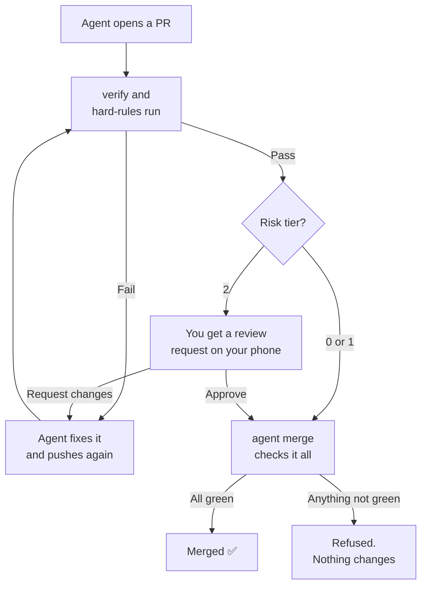
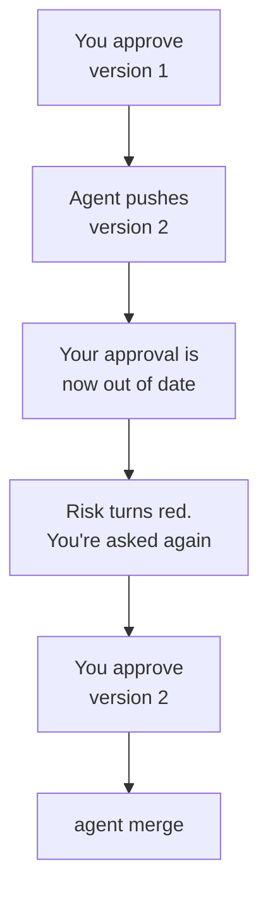

# How a change gets merged

A plain-English guide for the owner. No code or ADRs needed. Words in *italics* are in the [glossary](#glossary) at the end.

## The short version

- An AI agent makes a change and opens a *pull request* (PR).
- Three *checks* run on it automatically.
- The files it touches decide how risky it is: a *tier* from 0 to 2.
- Tier 0 or 1: no one needs to look. It merges once the checks pass.
- Tier 2: you get a notification on your phone. You approve it in the GitHub app.
- Your approval covers that exact version. If the agent changes anything after, you approve again.
- The agent merges only through one guarded command. It refuses unless everything is green.

## The picture

*The risk tier is worked out at the same time as the other checks. It's drawn after them to keep the picture simple.*

### If the agent pushes after you approve

## Step by step

### 1. The agent opens a PR

- The agent works on its own *branch*, never on `main`.
- It pushes and opens the PR as **loomspark-agent[bot]**, not as you. GitHub shows that name on everything it does.
- The PR description starts with a plain-English summary for you.

### 2. The checks run

Three checks run on every PR. You don't start them.

| Check | What it asks | If it fails |
|---|---|---|
| **verify** | Does the project still build, and do its tests pass? | The agent fixes the code and pushes again. |
| **hard-rules** | Does the change add anything that must never be committed? For example a password, a key, or a data file. | The agent removes it. The failure names the rule, file and line, never the text it matched, so a secret can't leak into the logs. |
| **risk** | Which files changed, and how risky are they? | It shows red while it waits for your approval. That's normal for tier 2. |

### 3. The risk tier is set

Each project lists its risky paths in its `.pipeline/config.yml`. The checks read the files the PR actually changes. Nobody's opinion sets the tier, including the agent's.

| Tier | Name | What it means today |
|---|---|---|
| **0** | auto-ship | Low risk, for example documentation. No approval. |
| **1** | auto-build | Ordinary code. No approval (a project can choose to require it). |
| **2** | escalate | Risky: CI, the pipeline's own rules, dependencies, personal data, sign-in, payments, legal pages and similar. Needs your approval. |

- The riskiest file sets the tier for the whole PR.
- Deleting a risky file counts as risky too.
- The file that sets the tiers is itself tier 2. So loosening a rule always needs you.

### 4. Tier 2: you approve

- GitHub sends you a **review request**. It shows up as a notification in the GitHub app.
- The PR has a comment from the risk check. It says why approval is needed and how to approve.
- Read the agent's summary at the top of the PR. Look at the files if you want to.
- To approve: tap **Approve** in the GitHub app (on the web: Files changed → Review changes → Approve).
- Not happy? Choose **Request changes** and say why. The agent fixes it and you're asked again.
- The risk check turns green by itself a moment after you approve. No new push needed.

Your approval is tied to the exact *commit* you saw. If anything is pushed after, it's out of date and you're asked again.

### 5. The guarded merge

The agent merges only with one command, `agent merge`. Before merging it checks, with GitHub:

- the PR is open, not a draft, and has no conflicts;
- every check has finished and none failed;
- the risk check is green: low risk, or approved by you for this exact commit.

If any of that isn't true, it refuses, says why, and changes nothing.

The merge is pinned to the commit it checked. If someone pushes in the gap between checking and merging, GitHub refuses the merge.

## What you do, and what you never need to do

**You do:**

- Approve tier-2 PRs from your phone (or ask for changes).
- Make changes to CI *workflow* files yourself. Agents can't push or merge those.
- Decide the open questions below when you're ready.

**You never need to:**

- Approve tier 0 or 1 changes.
- Press the merge button.
- Re-run a check, or add a label.
- Tell an agent "approved" in chat. It wouldn't count. Only your GitHub review counts.

## What agents can and can't do

**Agents can:** push branches, open PRs, comment, and merge with `agent merge` once everything is green.

**Agents can't:**

- **Approve.** An agent could submit a review, but only reviews from listed people count, and GitHub records who reviewed.
- **Change CI workflows.** The agent identity has no permission to. GitHub rejects the push.
- **Lower their own change's tier.** The tier rules live in `.pipeline/`, which is always tier 2. Changing them needs your approval.
- **Merge any other way.** The plain GitHub merge command is blocked for agents.

## Current limits

These are known gaps, written down so they don't surprise you.

- **Nothing merges unless an agent session is running.** The guarded merge runs on your machine, inside an agent session. A job on GitHub that merges green or approved PRs by itself is planned (milestone 6).
- **GitHub Free can't make checks required on private repos** ([K4](open-questions.md)). So a red check doesn't stop *you* pressing merge, and GitHub's own auto-merge isn't available. Agents still won't merge on red.
- **On your laptop, "agents act only as the agent" is a convention** ([K7](open-questions.md)). An agent session there could, in principle, reach your own GitHub login. Approvals don't depend on this: GitHub records who reviewed. Making it a hard wall means running agents somewhere only the agent's key exists.

## Glossary

- **Agent:** an AI coding tool doing work in a repo. Any tool can be the agent.
- **Branch:** a separate line of work in a repo. Changes are made on a branch, then merged into `main`.
- **Pull request (PR):** a request to merge a branch into `main`. It's where checks and reviews happen.
- **Commit:** one saved version of the code. Each has a unique id.
- **Head commit:** the latest commit on the PR. Approvals and checks apply to this one.
- **Push:** sending new commits to GitHub.
- **Check:** an automatic test run on each PR. Green means passed, red means failed or waiting.
- **CI:** "continuous integration": the machinery on GitHub that runs the checks.
- **Workflow:** a file in `.github/workflows/` that tells GitHub what to run.
- **Tier:** how risky a change is, from 0 (low) to 2 (needs you).
- **Review:** a person's verdict on a PR: approve, or request changes.
- **Merge:** adding the PR's changes to `main`.
- **loomspark-agent[bot]:** the agents' own GitHub identity (a *GitHub App*). It's separate from your account, so GitHub can tell its actions from yours.

## Where the detail lives

For maintainers: [design.md](design.md) (how it all works), [agent-identity.md](agent-identity.md) (setup), [ADR 0002](adr/0002-agent-identity-and-review-approval.md) (approvals) and [ADR 0003](adr/0003-guarded-merge.md) (guarded merge). This page is kept in step with them.
