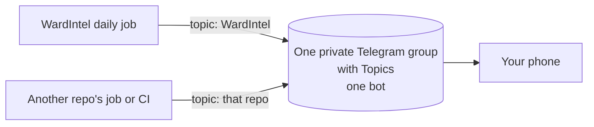

# Ops notices on Telegram

One place on your phone to see how every Loomspark repo is doing, without being pinged all day.



- **One bot, one private group, one topic per repo.** Every repo uses the same bot token and group; each sends to its own topic.
- **Two levels, chosen in code:**
  - 🔴 **alert**: something needs doing *today* (the daily job failed or found nothing, credits are low, a source went private, a build on `main` is broken, a risky PR is waiting for your review). Sent with sound.
  - 🗒 **digest**: one quiet summary per repo per day (what ran, counts, credits). Sent silently: it's there when you look.
  - Everything else stays in the repo's own database, admin pages and logs. Messages link there rather than copying detail.
- **It never breaks the job.** If Telegram is down, or the settings are missing, the job carries on. Without settings it does nothing, which is the normal state on laptops and previews.

## What a message may contain

A notice is a **fixed title** written in code, plus **facts** (a label and a number, yes/no, or a short one-line string such as a status or a name) and **https links**. There is no free-text body, and strings are capped at 80 characters on one line.

Callers pass **counts, statuses, names and links only**: never user content (posts, comments, messages, emails, personal data) or anything derived from it, such as a summary or a quote. This matches each project's own privacy rules (for Ward Intel: FR-PRV, "raw content is never logged or shown"). The shape makes the right thing easy; the caller is still responsible for what goes in it.

## One-time setup (owner)

1. In Telegram, message **@BotFather**, send `/newbot`, and keep the token it gives you somewhere safe. Never paste it into a chat, issue or PR.
2. Create a private group, add the bot, and turn on **Topics** in the group settings. Create one topic per repo (e.g. *WardIntel*).
3. In each repo's topic, send `/start@<your bot's username>` so the bot sees the topic.
4. Find the IDs without sharing the token: with the token in your shell's environment, run from the kit checkout

   ```bash
   TELEGRAM_BOT_TOKEN=... npm run kit -- notify --discover
   ```

   It prints lines like `TELEGRAM_CHAT_ID=-100... TELEGRAM_TOPIC_ID=7 (Loomspark Ops / WardIntel)`.
5. Add the settings to the repo's host (e.g. Vercel, **Production only** so previews stay quiet):

| Variable | Value |
|---|---|
| `TELEGRAM_BOT_TOKEN` | The bot's token (secret; the same for every repo) |
| `TELEGRAM_CHAT_ID` | The group's ID (the same for every repo) |
| `TELEGRAM_TOPIC_ID` | This repo's topic ID. Unset sends to the group's General topic |
| `NOTIFY_SOURCE` | Optional label shown under the title, e.g. `wardintel` |

## Using it

**From TypeScript** (a Next.js app, a script): vendor [`src/notify.ts`](../src/notify.ts), a single file with no imports, into the project (e.g. `src/lib/vendor/pipeline-kit-notify.ts`) with a header saying which kit commit it came from. The kit repo is private, so projects can't install it as a package on their hosts; copying one small file is simpler than a registry. To update, copy the file again and bump the header.

```ts
import { notify } from "./vendor/pipeline-kit-notify";

await notify({
  level: "digest",
  title: "Daily collection",
  facts: [{ label: "Groups", value: "56/56" }, { label: "Posts", value: 812 }],
  links: [{ label: "Admin", url: "https://example.invalid/admin" }],
});
// → { sent: true } | { sent: false, reason: "not-configured" | "invalid" | "failed", detail? }
```

**From a shell or CI step:**

```bash
node <kit>/src/cli.ts notify --level alert --title "Build on main failed" \
  --fact "Commit=abc1234" --link "Run=https://github.com/org/repo/actions/runs/1"
```

It exits 0 whether it sent or skipped, so it can't fail the step. Bad usage (no level, an over-long value) exits 2.

## Rules of thumb

- If you'd want to be woken for it, it's an **alert**; if you'd only want to know at a glance, it's in the **digest**; otherwise it's a log line.
- Send each alert once per event: record that you sent it (e.g. a column on the run row), so a retry or second run doesn't repeat it.
- Link to the detail; don't copy it.

Decision record: [ADR 0005](adr/0005-telegram-ops-notices.md).
